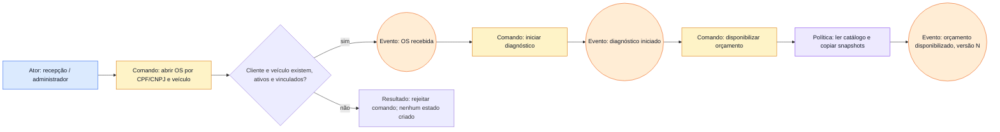
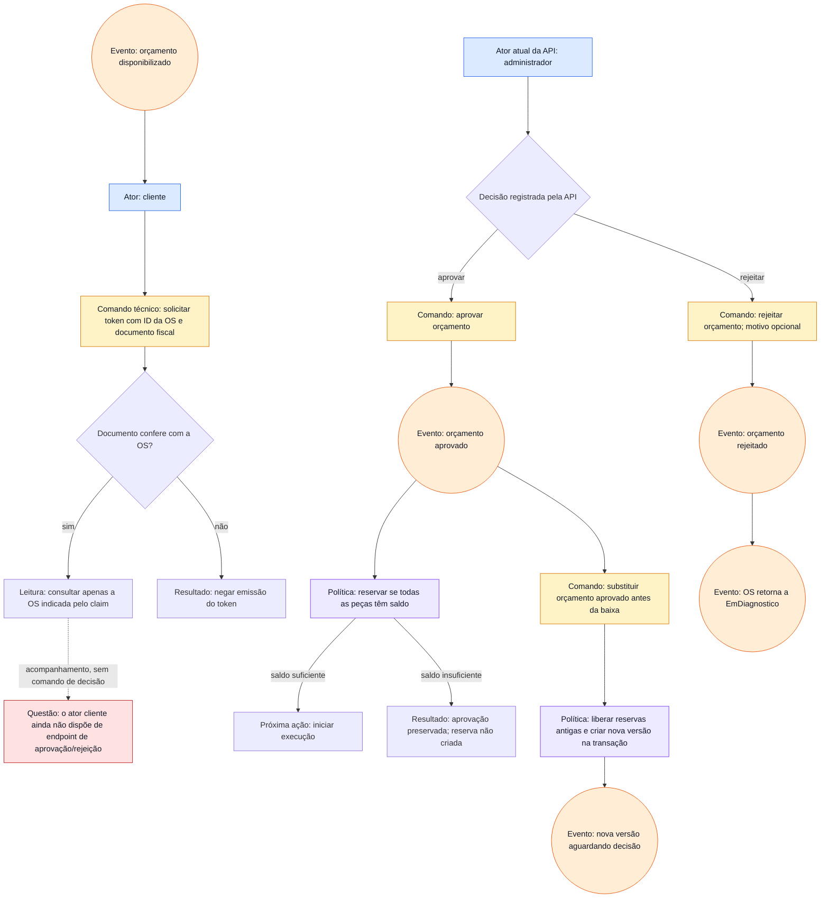
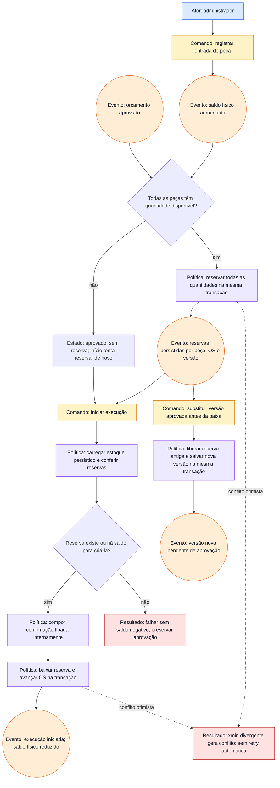

# Fluxos de domínio em Mermaid

**Estado:** diagramas de fluxo derivados do código e da API auditados em 2026-11-03. São artefatos de apoio para Event Storming, não ata de reunião nem prova de que os três workshops foram realizados. Os participantes do grupo ainda precisam validar atores, políticas e perguntas em aberto e publicar/exportar os resultados finais.

As caixas marcadas **Comando** são intenções; as caixas **Evento** são fatos de negócio em notação. O código não publica esses fatos em broker e não implementa event sourcing.

## 1. Recebimento da OS e diagnóstico

**Código correspondente:** `POST /api/ordens-de-servico`, `POST /{id}/diagnostico`, `POST /{id}/orcamentos`; validação e snapshots em `OficinaApplicationService`.

## 2. Orçamento e decisão

**Código correspondente:** `POST /api/auth/cliente` emite token de consulta; `/api/consulta/ordens-de-servico/{id}` lê a OS do claim. Aprovação e rejeição estão nas rotas administrativas `POST /api/ordens-de-servico/{id}/orcamentos/aprovacao` e `/rejeicao`. O ator da decisão precisa ser validado pelo grupo: não há endpoint de decisão autenticado como cliente.

## 3. Acompanhamento da OS

```mermaid
stateDiagram-v2
    [*] --> Recebida: abrir OS
    Recebida --> EmDiagnostico: iniciar diagnóstico
    EmDiagnostico --> AguardandoAprovacao: disponibilizar versão N
    AguardandoAprovacao --> EmDiagnostico: rejeitar; guardar decisão e motivo opcional
    AguardandoAprovacao --> AguardandoAprovacao: aprovar; flag OrcamentoAprovado = true
    AguardandoAprovacao --> EmExecucao: iniciar; confirmar reserva e baixar estoque
    EmExecucao --> Finalizada: finalizar; guardar instante
    Finalizada --> Entregue: entregar veículo
    Entregue --> [*]

    state AguardandoAprovacao {
        [*] --> Pendente
        Pendente --> Aprovada: decisão gravada sem mudar status oficial
        Aprovada --> NovaVersao: substituir antes da baixa
        NovaVersao --> Pendente
    }
```

O cliente pode obter token de consulta e ler status, total do orçamento atual e horários de execução da própria OS. A consulta compara o ID pedido com `ordem_id` no JWT. As demais transições usam endpoints administrativos. O health check mede o processo, não a prontidão do banco.

## 4. Estoque, reserva e baixa

**Invariantes:** `disponível = físico − reservado`; ambos são quantidades inteiras; não reservar acima do disponível; baixar somente reserva existente; mudança concorrente em OS/estoque resulta HTTP 409. Os testes atuais cobrem o cenário com uma peça e conflito de atualização da raiz de estoque; não comprovam ainda todas as corridas simultâneas multi-peça.

## Pontos para as sessões do grupo

1. Confirmar quem pode aprovar/rejeitar e se cliente precisa de endpoint autenticado de decisão.
2. Validar se um fluxo com `Peca` atende também ao termo “insumo” do desafio.
3. Decidir devolução, cancelamento e reparos adicionais; não há fluxos correspondentes implementados.
4. Confirmar se tempo médio deve ser medido por OS inteira ou por serviço individual.
5. Anexar atores/participantes, data, decisões e export público dos boards reais antes de marcar os workshops como concluídos.
